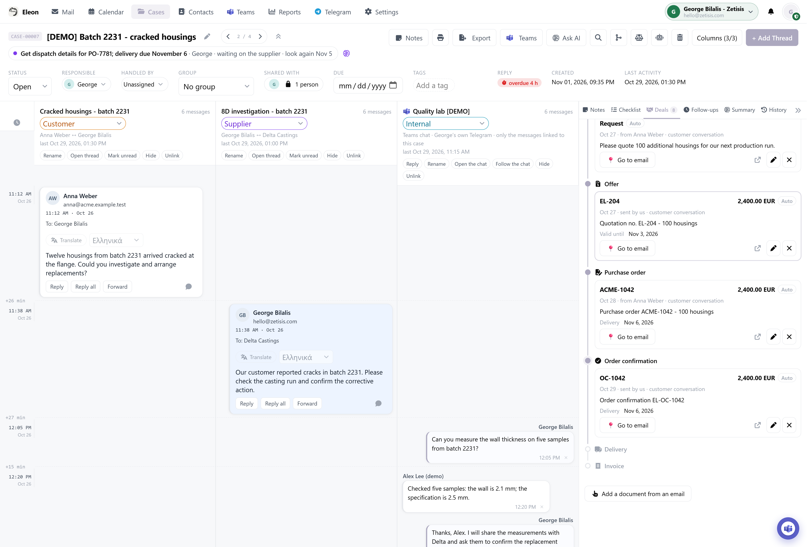

<p align="center"></p>

# Eleon

**One customer issue. Three conversations. One timeline.**

Eleon is an open-source, self-hosted help desk and shared inbox for Outlook and
Gmail. It is a Zendesk alternative for teams handling customer support by email,
with case management, team collaboration and optional AI.

A customer reports a damaged batch. You email the supplier, ask your quality team
to check the parts, and keep the customer updated. Each conversation has its own
thread, but they all belong to the same job.

Eleon brings those threads into one case. Connect Outlook or Gmail, link the
conversations, and give your team a shared view of what happened and what needs
to happen next. It runs on your own server and the source is here on GitHub.

[Try the interactive demo](https://eleon.app/#demo) ·
[Download the preview](https://github.com/giorgosbil/eleon/releases) ·
[Browse the features](https://eleon.app/features/)

[](assets/githubmain.png)

*A demo case with fictional messages: customer and supplier email threads, the quality team chat, and the path from a quote request to an order. Click the screenshot to view it full size.*

## Working a case

- Start a case from an email and add the other conversations about it.
- Assign an owner, leave an internal note, and write down the next step.
- Read and reply from the workspace. Email changes sync with Outlook or Gmail.
- Ask AI to summarize the case or draft a reply, then review its work.

You can use Eleon for everyday email too. Shared inboxes, search, automation and
the other tools are described in the [feature directory](https://eleon.app/features/).
AI is optional and uses the provider or compatible local endpoint you configure.

## A Zendesk alternative for email support

If you are looking for an email ticketing system, Eleon calls each piece of work
a **case**. One case can hold several email threads and an internal discussion,
so your customer, supplier and colleagues can stay in their own conversations.
The team shares the case, its owner, notes and next step.

Comparing Zendesk, Chatwoot or Front? Try Eleon when you want a self-hosted shared
inbox with this case workflow and your existing Outlook or Gmail accounts.
This is an early public preview; test the workflows you need before moving your
team over. The full application is available under AGPL-3.0-only.

## Try it locally

Install Git and [Docker Desktop](https://www.docker.com/products/docker-desktop/)
(Windows/macOS), or Docker Engine with Compose on Linux.

Open Docker Desktop and wait for **Engine running**. Installing it alone does not
start the engine. On Windows, follow any WSL update/restart prompt and use Linux
containers. Check that this works before continuing:

```sh
docker info
```

Testing inside a Hyper-V VM? Enable nested virtualization first; follow the
[VM setup steps](INSTALL.md#testing-in-a-hyper-v-vm).

Clone the repository into a folder of your own, for example `C:\dev` on Windows
(not `C:\Windows\System32`, where an administrator PowerShell opens), and enter it once:

```sh
git clone https://github.com/giorgosbil/eleon.git
cd eleon
```

Already downloaded or cloned it? Open the folder containing `Start.ps1` and
`compose.yaml`; you can skip the two commands above.

On Windows, run this in PowerShell:

```powershell
powershell -ExecutionPolicy Bypass -File .\Start.ps1
```

On Linux or macOS:

```sh
sh start.sh
```

Startup builds the application, creates the database, prints a first-admin setup
code and copies it to the clipboard. The setup page
(<http://localhost:8080/other_things/web/setup.php>) opens by itself: paste the
code and create your account.

To connect Outlook or Gmail, open **Settings → Mailbox** in the app. It opens the
setup guide at the right step, with your installation's address filled in.
Prefer a guided installation from the very start? Open `welcome.html` in the cloned
folder. [INSTALL.md](INSTALL.md) and [local setup](docs/LOCAL.md) cover the details.

Keep `.env` and your encryption key private, and back up the key with your data.

## Where things stand

This is the first public preview. Fresh Docker installation, account setup and
access-control checks passed. Live mail, AI and messaging connections weren't
part of that release check. Read the [testing notes](docs/PUBLIC-RELEASE.md) for
what was tested, and try your provider connections before relying on a deployment.

## Hosting and support

The full application is open source, with no paid feature tiers or software trial.
You pay for your own infrastructure and any provider or AI usage.

For help with deployment, migration, training or support,
[contact George](mailto:georgebilalis@hotmail.com). Managed hosting is planned.

## Contributing

Bug reports, documentation fixes and code contributions are welcome.
See [CONTRIBUTING.md](CONTRIBUTING.md). Use fictional data in public issues;
report security problems privately through [SECURITY.md](SECURITY.md).

## License

[AGPL-3.0-only](LICENSE) · Copyright © 2026 George Bilalis.
Third-party components keep their own licenses; see [the notices](THIRD_PARTY_NOTICES.md).
