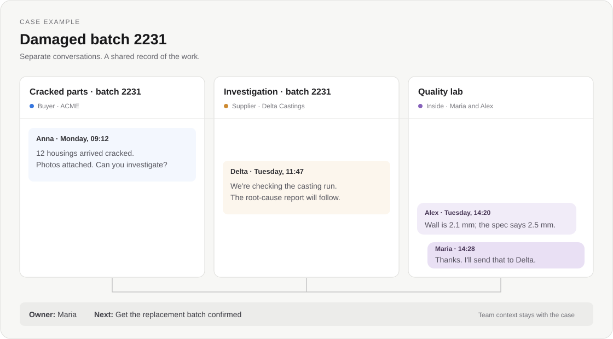

<p align="center"></p>

# Eleon

**One customer issue. Three conversations. One timeline.**

A customer reports a damaged batch. You email the supplier, ask your quality team
to check the parts, and keep the customer updated. Each conversation has its own
thread, but they all belong to the same job.

Eleon brings those threads into one case. Connect Outlook or Gmail, link the
conversations, and give your team a shared view of what happened and what needs
to happen next. It runs on your own server and the source is here on GitHub.

[Try the interactive demo](https://eleon.app/#demo) ·
[Download the preview](https://github.com/giorgosbil/eleon/releases) ·
[Browse the features](https://eleon.app/features/)

[](https://eleon.app/#demo)

*An illustrated case example. Open the demo to switch between the timeline,
next steps, notes and AI summary.*

## Working a case

- Start a case from an email and add the other conversations about it.
- Assign an owner, leave an internal note, and write down the next step.
- Read and reply from the workspace. Email changes sync with Outlook or Gmail.
- Ask AI to summarize the case or draft a reply, then review its work.

You can use Eleon for everyday email too. Shared inboxes, search, automation and
the other tools are described in the [feature directory](https://eleon.app/features/).
AI is optional and uses the provider or compatible local endpoint you configure.

## Try it locally

You need Git and Docker Desktop with Linux containers, or Docker Engine with Compose.

```sh
git clone https://github.com/giorgosbil/eleon.git
cd eleon
```

On Windows, run this in PowerShell:

```powershell
powershell -ExecutionPolicy Bypass -File .\Start.ps1
```

On Linux or macOS:

```sh
sh start.sh
```

Startup builds the application, creates the database and prints a first-admin
setup code. Open <http://localhost:8080/other_things/web/setup.php> and use that
code to create your account. Then configure your Microsoft or Google connection.
`welcome.html` walks through the configuration; [INSTALL.md](INSTALL.md) and
[local setup](docs/LOCAL.md) cover the details.

Keep `.env` and your encryption key private, and back up the key with your data.

## Where things stand

This is the first public preview. Fresh Docker installation, account setup and
access-control checks passed. Live mail, AI and messaging connections weren't
part of that release check. Read the [testing notes](docs/PUBLIC-RELEASE.md) for
what was tested, and try your provider connections before relying on a deployment.

## Hosting and support

The full application is open source, with no paid feature tiers or software trial.
You pay for your own infrastructure and any provider or AI usage.

For help with deployment, migration, training or support,
[contact George](mailto:georgebilalis@hotmail.com). Managed hosting is planned.

## Contributing

Bug reports, documentation fixes and code contributions are welcome.
See [CONTRIBUTING.md](CONTRIBUTING.md). Use fictional data in public issues;
report security problems privately through [SECURITY.md](SECURITY.md).

## License

[AGPL-3.0-only](LICENSE) · Copyright © 2026 George Bilalis.
Third-party components keep their own licenses; see [the notices](THIRD_PARTY_NOTICES.md).
